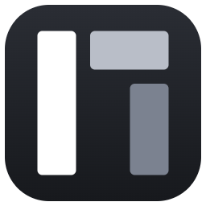

English | <a href="README.ko.md">한국어</a>

**AceDeck** is a free and open-source organizer for people who work on a computer. It was previously called Freeter-SWH.

Gather everything you need for your work in one place, organized by projects and workflows. Bring it up anytime with
`Ctrl`/`Cmd` + `Shift` + `Space` (this fork's default, configurable) or from the system tray, and switch between
workflows in a click. Spend less on context switching and stay focused on the task at hand.

New here? Start with the [user guide](docs/GUIDE.md) (in Korean).

> AceDeck is a fork of [FreeterApp/Freeter][upstream] by Alex Kaul (GPL-3.0). It builds on the original with usability
> improvements and new features, and was renamed from Freeter-SWH to AceDeck on 2026-11-15. It keeps the original's
> GPL-3.0 license and copyright notices. Every difference from the original is listed in
> [`docs/CHANGES.md`](docs/CHANGES.md) (in Korean).

Original Freeter: [**Home**][home] | [**Download**][download] | [**Community**][community] | [**Sponsor**][donate] |
[**Roadmap**][roadmap] | [**Feature requests**][featurerequests] | [**Bug reports**][bugreports]

## Highlights

- **One bar at the top**: the Top Bar's widgets merge into the workflow tab bar (widgets on the left, tabs on the
  right). The workflow bar can also sit at the bottom, or on the left or right as a side panel.
- **Webpage widget that works like a browser**: tabs, find in page, zoom, mute, keyboard shortcuts, page translation,
  image copy, downloads to a folder you choose, custom JavaScript action buttons and HTTP authentication.
- **Terminal widget**: PowerShell, Command Prompt, Git Bash or WSL inside a widget, with tabs. Run Claude Code or Codex
  in it.
- **AI agent control**: AI agents such as Claude Code and Codex work with projects, workflows and widgets through the
  `acedeck` CLI or as an MCP server (`acedeck mcp`). Write actions wait for your OK.
- **New widgets**: File Explorer (favorite folders as a tree, with subfolder search), D-Day, Clock (world time zones),
  Calculator and System Monitor.
- **Better widgets**: Note and To-Do List shared across workflows, Web Query with many built-in engines and several
  search boxes, Link and File Opener with automatic icons and titles, Timer with pause and desktop notifications.
- **Local-only usage analytics** (opt-in): time per workflow and app, an activity timeline and a report in your
  browser. Nothing leaves your computer.
- **Themes**: 10 themes, a System option that follows the OS light/dark mode, and `Ctrl`+`Shift`+`L` to switch between
  light and dark. On Windows and Linux the title bar takes the theme colors too.
- **Workflow area**: a finer 32×16 grid, a custom background color or image, and a widget that fails shows its error in
  its own place instead of taking the whole workflow down.
- **Your data**: Back Up Data and Restore Data in the File menu, atomic saves, and recovery from a damaged state file.
- **Update notice**: checks GitHub Releases at start and once a day, and tells you when a new version is out.
- **Accessibility**: screen reader names, visible focus, 4.5:1 text contrast, and menu or button alternatives to
  drag and drop.

The full list with dates is in [README.ko.md](README.ko.md) and [`docs/CHANGES.md`](docs/CHANGES.md) (in Korean).

## Supported operating systems

- Linux: most distributions, Intel 64-bit.
- Windows 10 or later, Intel 64-bit.
- macOS: this fork ships no installer. The macOS code is still in the source, so you can build it yourself, but it is
  untested.

## Installers

Download the installers from [GitHub Releases][releases].

- Windows: `msi` (installer) or `zip` (unpack and run)
- Linux: `tar.xz`
- macOS: none. Only releases up to `2.8.0-swh.17` include a `dmg`.

For the original Freeter, use its [download page][download].

## Building from source

Requirements (only for building):

- [NodeJS](https://nodejs.org/en)
- [Yarn 1 (Classic)](https://classic.yarnpkg.com/lang/en/)

Steps:

1. Clone this repository or download the source.
2. If you downloaded an archive, unpack it and open its folder.
3. Run these commands in order:
  1. `yarn` (install dependencies)
  2. `yarn run prod` (compile)
  3. `yarn run package` (package)

The installable packages are created in `./dist`. Packaging is set up for Windows and Linux only. On macOS,
electron-builder uses its defaults (untested).

## License

AceDeck, like Freeter, is free software: you can redistribute it under the terms of the [license][license].

[home]: https://freeter.io/
[download]: https://freeter.io/download
[releases]: https://github.com/w1010k/FreeterBySwh/releases
[community]: https://community.freeter.io/
[donate]: https://freeter.io/sponsor
[roadmap]: https://community.freeter.io/topic/2/planned-features
[featurerequests]: https://community.freeter.io/category/6/feature-requests
[bugreports]: https://community.freeter.io/category/7/bug-reports
[license]: https://github.com/FreeterApp/Freeter/blob/master/COPYING
[upstream]: https://github.com/FreeterApp/Freeter
